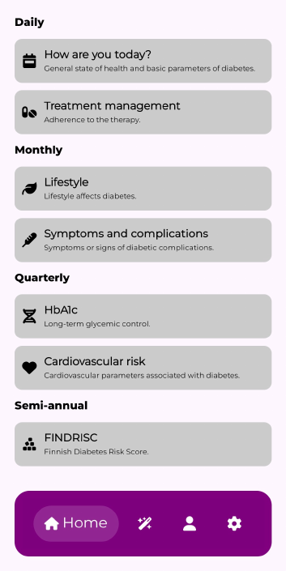
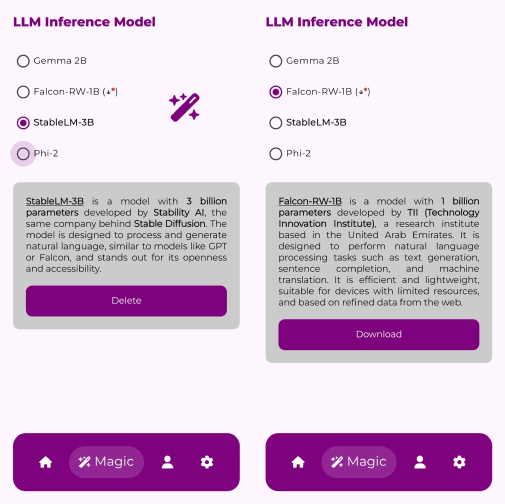
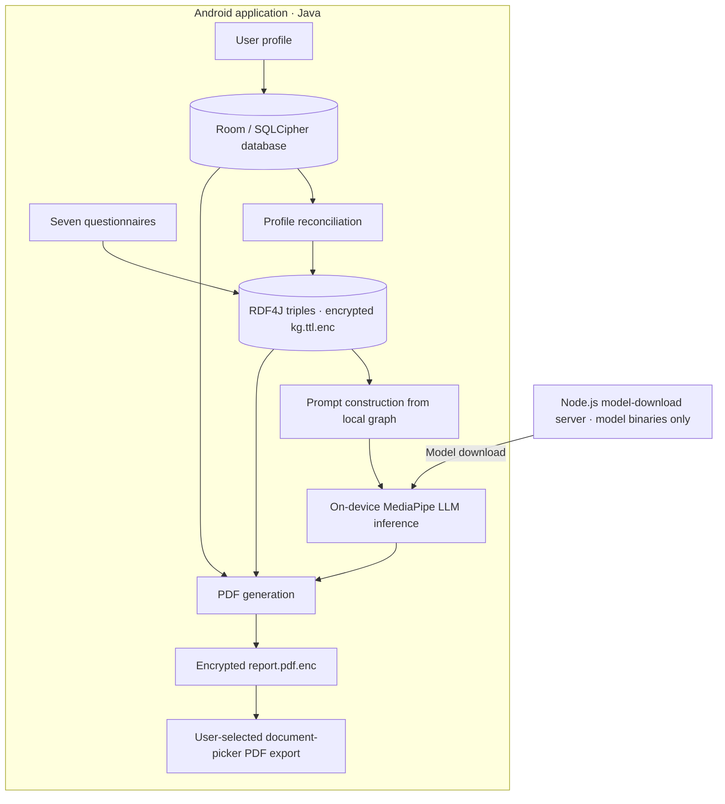
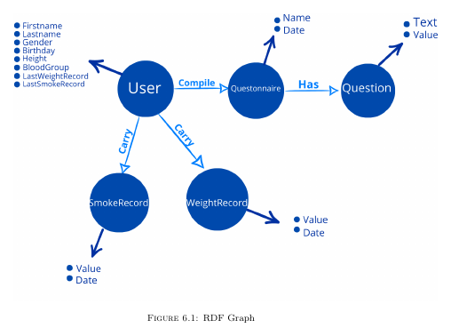

# Ringo-Star

Android health diary for diabetes-oriented self-monitoring, combining an RDF knowledge graph, local LLM inference, and exportable PDF reports.

Ringo-Star is an academic project developed for the *Semantic Web and Social Networks* course (Academic Year **2024–2025**) during an Erasmus+ exchange at **[Poznan University of Technology](https://put.poznan.pl/en)** (Poland), as part of the **Computer Engineering** degree program at **[Politecnico di Bari](https://www.poliba.it/en/laurea-magistrale-ingegneria-informatica)** (Italy).

Users can record profile information and responses to seven questionnaires. The app represents those observations as RDF triples, prepares a structured natural-language prompt from its local graph, and uses a compatible on-device model to generate a summary. **It is not clinically validated or a medical device.**

## Preview

The following screenshots illustrate selected representative features of the application and do not constitute an exhaustive overview of its interface.

<p align="center">
  
  
</p>

*Questionnaire home and on-device language-model selection.*

## Features

- Profile management and four-digit PIN access with rate limiting, backed by an encrypted Room database (SQLCipher).
- Seven questionnaires: daily health, treatment, lifestyle, symptoms and complications, HbA1c, cardiovascular risk, and FINDRISC.
- RDF4J knowledge graph serialized as Turtle and stored in an authenticated AES-GCM encrypted private file. The app uses ordinary RDF triples; **RDF-star quoted triples are not implemented**.
- On-device inference via MediaPipe Tasks GenAI with separately installed compatible Gemma 2B, Falcon-RW-1B, StableLM-3B, or Phi-2 binaries.
- A locally generated report containing profile information, a model response, and RDF statements, with explicit user-selected PDF export.
- Express server exposing four model-download endpoints.

## Architecture



The server distributes **model files only**. Patient profile and questionnaire data remain local to the app. Updating a profile synchronizes its core RDF properties while retaining questionnaire history; Room is used to reconcile profile values before an inference operation. Room and the encrypted RDF file are separate stores, so crash-time cross-store atomicity is not guaranteed.



*Knowledge graph structure from the academic report (Figure 6.1).*

## Technology Stack

| Area | Technology |
| --- | --- |
| Android | Java, Android Gradle Plugin 8.6.0, Gradle 8.7, compile/target SDK 35, min SDK 26 |
| UI / local data | AndroidX, Material Components, Room 2.6.1, SQLCipher 4.20.0, Android Keystore, ruler-picker 1.1 |
| Knowledge graph | Eclipse RDF4J 4.3.2, Turtle serialization |
| Local inference | MediaPipe Tasks GenAI 0.10.18 |
| PDF generation | Android `PdfDocument` |
| Download API | Node.js 18+, Express 4.21.x, npm lockfile |

The exact declared libraries are listed in `android/gradle/libs.versions.toml` and `server/package-lock.json`. Android needs JDK 17 and SDK Platform 35.

## Repository Structure

```text
android/  # Android Studio source, tests and Gradle Wrapper
server/  # Express model-download API and tests
  ringo_cloud_storage/
    download/  # Model installation directory (binaries not included)
scripts/  # Legacy MediaPipe converter invocation wrapper
docs/
  academic-report.pdf  # Privacy-redacted public copy of the academic PDF
  images/  # Two app screenshots and the RDF architecture figure
  model-setup.md  # Model sources, conversion, verification and setup
  local-data-security.md  # Storage, migration, PIN and export protections
THIRD_PARTY_NOTICES.md  # Third-party sources and licensing obligations
.env.example  # Supported environment-variable reference
```

## Getting Started

### Environment Configuration

The repository includes [`.env.example`](.env.example), documenting **all eight supported environment variables** read by the existing Node.js and Gradle configuration. Copy its values into your **shell environment** if you want to override defaults. No `.env` file or dotenv dependency is needed: neither Node.js nor Gradle automatically imports `.env.example`.

For Linux/macOS, from the repository root, load the example values into the current terminal session before running the server or Gradle:

```bash
set -a
. ./.env.example
set +a
```

For PowerShell, from the repository root:

```powershell
Get-Content .env.example | Where-Object { $_ -match '^[A-Z][A-Z0-9_]*=' } | ForEach-Object {
    $name, $value = $_ -split '=', 2
    [Environment]::SetEnvironmentVariable($name, $value, 'Process')
}
```

Keep the committed example generic; after loading it, override individual variables in your terminal with your deployment-specific values. Empty entries use the defaults described below. **Do not commit locally downloaded model binaries or private configuration.**

| Variable | Used by | Default / purpose |
| --- | --- | --- |
| `HOST` | Node.js | `127.0.0.1`; bind address for model API |
| `PORT` | Node.js | `3000`; API port (1–65535) |
| `RINGO_MODEL_DIR` | Node.js | `server/ringo_cloud_storage/download/` (resolved internally); optional custom model directory |
| `RINGO_MODEL_SERVER_URL` | Android/Gradle | Empty: debug uses `http://10.0.2.2:3000`; set a reachable URL for other devices or an HTTPS URL for release downloads |
| `RINGO_MODEL_SHA256_GEMMA2B` | Android/Gradle | Optional trusted SHA-256 for `gemma2b.bin` |
| `RINGO_MODEL_SHA256_FALCON_RW1B` | Android/Gradle | Optional trusted SHA-256 for `falcon_rw1b.bin` |
| `RINGO_MODEL_SHA256_STABLE_LM3B` | Android/Gradle | Optional trusted SHA-256 for `stable_lm3b.bin` |
| `RINGO_MODEL_SHA256_PHI2` | Android/Gradle | Optional trusted SHA-256 for `phi2.bin` |

Android also accepts the equivalent Gradle flags `-PmodelServerUrl=...` and `-PmodelSha256_<model>=...`. A supplied Gradle property takes precedence over its environment variable; see [Model setup](docs/model-setup.md).

### 1. Install and Run the Model Server

Install Node.js 18+ and npm. From the repository root:

```bash
cd server
npm ci
npm test
npm start
```

The server listens on `127.0.0.1:3000` by default. To use it from an Android device on the same trusted LAN, set `HOST=0.0.0.0` when starting it:

- Linux/macOS: `HOST=0.0.0.0 PORT=3000 npm start`
- Windows PowerShell: `$env:HOST='0.0.0.0'; $env:PORT='3000'; npm start`

The server does not authenticate requests. Do not expose it directly to the public internet; use appropriate HTTPS and access control if externally hosted.

### 2. Obtain and Install Models

**No `.bin` weights are bundled.** See [Model setup](docs/model-setup.md) for upstream checkpoints, access terms, a configurable conversion wrapper, checksum generation and runtime verification steps.

The server expects these names in `server/ringo_cloud_storage/download/`:

| Model | Filename | Endpoint |
| --- | --- | --- |
| Gemma 2B | `gemma2b.bin` | `/api/download/gemma2b` |
| Falcon-RW-1B | `falcon_rw1b.bin` | `/api/download/falcon_rw1b` |
| StableLM-3B | `stable_lm3b.bin` | `/api/download/stable_lm3b` |
| Phi-2 | `phi2.bin` | `/api/download/phi2` |

The server responds with HTTP 404 when a binary is missing or empty. Merely installing upstream weights without conversion does not make them compatible with this application. A SHA-256 of a converted binary can be pinned into the Android build; without a pin, full cryptographic verification is unavailable.

### 3. Build Android

Requirements: Android Studio, JDK 17, Android SDK Platform 35 and the SDK Build Tools appropriate for Android Gradle Plugin 8.6.0. On Linux/macOS:

```bash
cd android
./gradlew assembleDebug
```

On Windows (PowerShell/cmd):

```bat
gradlew.bat assembleDebug
```

Alternatively, open the `android/` folder in Android Studio. The debug build uses `http://10.0.2.2:3000` for access to the host from the Android emulator. For a physical device, configure a reachable LAN URL at build time:

```bash
./gradlew assembleDebug -PmodelServerUrl=http://192.168.1.100:3000
```

That address is an **example**, not a deployed service. You can instead use the `RINGO_MODEL_SERVER_URL` environment variable. To pin a downloaded model's checksum, add e.g. `-PmodelSha256_phi2=YOUR_64_HEX_SHA256` to the build command; see [Model setup](docs/model-setup.md). Only debug builds permit local HTTP. Release builds require an explicitly configured `https://` URL, such as:

```bash
./gradlew assembleRelease -PmodelServerUrl=https://your-server.example
```

The example host must be replaced with an actual service endpoint.

### 4. Use the App

1. Create a profile and a four-digit PIN.
2. Complete one or more questionnaires.
3. Select a supported model and download a compatible binary from the server.
4. Generate an on-device summary from the RDF data.
5. Select **Export PDF**, then choose a destination using Android's document picker. Exported reports are plaintext and must be handled appropriately.

## Privacy and Security

Profiles are stored in a SQLCipher-encrypted Room database; graph and report files are AES-GCM encrypted in app-private storage using Android Keystore. The PIN is salted and hashed with PBKDF2-HMAC-SHA256; repeated failed attempts are rate-limited. Sensitive screens restrict OS screenshots. The Android document picker controls when a report leaves the app's encrypted storage.

See [Local data security](docs/local-data-security.md) for migration details, security boundaries and the distinction between private reports and exported PDFs. The protections do not prevent compromise of the operating system or redistribution of a PDF after export.

## Tests

```bash
cd server && npm test
cd android && ./gradlew testDebugUnitTest
```

On Windows, use `gradlew.bat testDebugUnitTest` for the Android unit tests. The model setup guide documents the conversion options and how to check a converted model with the project's MediaPipe runtime. LLM-generated text should not be treated as professional medical advice.

## Documentation

The app transforms questionnaire responses and temporal health observations into an RDF graph and extracts a language-model prompt. The academic report includes sample RDF statements and qualitative model responses; it is not a reproducible quantitative benchmark.

[Read the academic report (English, PDF; public copy)](docs/academic-report.pdf). This is a 57-page copy of the 2024 university submission with student IDs and identifying details in one illustrative RDF example removed. The unchanged university submission is preserved outside this repository. Citations and academic authorship remain intact.

## Contributors

- [Cosimo Curri](https://github.com/cosimo-curri)
- [Selma Jawhari Idrissi](https://github.com/selmaidrissi16-01)

## License and Third-Party Materials

The original project code is licensed under the [MIT License](LICENSE). Third-party materials remain subject to their respective licenses and terms.

External libraries, bundled assets and model checkpoints remain subject to their own terms. Consult [Third-party notices](THIRD_PARTY_NOTICES.md); no third-party model weights are redistributed.
